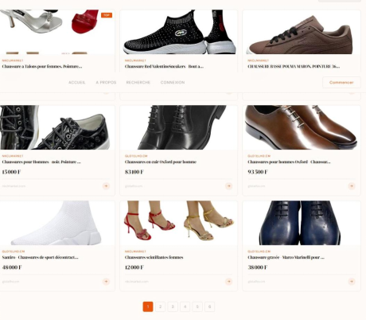

# KMERSEARCH

KMERSEARCH est un moteur de recherche sémantique de produits. Il collecte les
produits de Glotelho, transforme leur contenu en vecteurs avec Voyage AI,
stocke ces vecteurs dans Weaviate, puis expose une recherche HTTP consommée par
une interface web.

L’objectif est de rester performant lorsque le catalogue devient très
important : une recherche vectorielle évite de comparer la requête avec chaque
description caractère par caractère. Weaviate utilise un index de recherche
approximative des voisins les plus proches (ANN) pour retrouver rapidement les
produits dont le sens est proche de la requête.

## Aperçu de l’interface

L’interface présente les produits trouvés sous forme de cartes avec leur image,
leur prix, leur source et un lien vers la fiche produit.




## Architecture

```text
Glotelho sitemap
       |
       v
Scrapy ──> products.json ──> script d'ingestion ──> Weaviate
                                                        |
Navigateur ──> Frontend Vite/Preact ──> API Flask ─────┘
                                      |
                                      └── Redis (cache des requêtes)
```

### Composants

- **Collecte** : le spider Scrapy `glotelho` lit le sitemap et extrait l’URL,
  le titre, le prix, la description et les images de chaque produit.
- **Base vectorielle** : Weaviate conserve la collection `Produtglotelho`.
  Les champs textuels sont vectorisés par le module Voyage AI et les requêtes
  utilisent `near_text`.
- **API** : Flask expose `GET /search?query=...` et renvoie les propriétés des
  produits trouvés. `GET /image?url=...` sert de proxy pour les images.
- **Cache** : Redis conserve une réponse de recherche pendant une heure afin
  d’éviter de recalculer les mêmes recherches.
- **Interface** : le frontend Vite/Preact affiche les résultats sous forme de
  cartes et appelle l’API publique.
- **Déploiement** : Docker Compose orchestre Weaviate, Redis, Flask,
  Nginx et Traefik. Traefik gère les domaines HTTPS et les certificats.

## Pourquoi une base vectorielle pour une très grande base ?

Une base relationnelle classique est adaptée aux filtres exacts (`price =`,
catégorie, identifiant), mais une recherche comme « ordinateur portable pour
la bureautique » demande de comprendre le sens de la phrase. Le pipeline
vectoriel fonctionne ainsi :

1. le texte du produit est converti en vecteur numérique (embedding) ;
2. l’index ANN organise les vecteurs proches ;
3. la requête est convertie avec le même modèle ;
4. Weaviate retourne les voisins les plus pertinents sans parcourir
   séquentiellement tout le catalogue ;
5. Redis accélère encore les requêtes répétées.

Le gain dépend de la taille des vecteurs, du matériel, de la configuration de
l’index et du niveau de rappel recherché. Une base vectorielle n’empêche pas
de conserver une base SQL pour les données transactionnelles : les deux
solutions peuvent être utilisées ensemble, la base vectorielle servant alors
à la découverte sémantique.

## Prérequis

- Docker et Docker Compose
- Python 3.11 ou supérieur pour les scripts locaux
- Node.js 20 ou supérieur pour le frontend local
- Une clé API Voyage AI
- Un accès réseau au site source et à Weaviate

## Configuration

Dans `glotelhoscrape/spiders`, créer un fichier `.env` (il ne doit pas être
commité) :

```dotenv
VOYAGEAI=votre-cle-voyageai
```

Le backend utilise également `REDIS_HOST`, `REDIS_PORT`, `WEAVIATE_HOST` et
`WEAVIATE_PORT`. En Docker, leurs valeurs sont déjà fournies par
`docker-compose.yml`.

## Installation et lancement avec Docker

Depuis `glotelhoscrape/spiders` :

```bash
docker compose build
docker compose up -d
docker compose ps
```

Le backend est disponible sur le port `5000` à l’intérieur du réseau Docker,
Weaviate sur `8080`, et Redis sur `6379`. En production, les domaines
configurés dans Compose sont `test.kmersearch.com` et
`test-api.kmersearch.com`.

Tester l’API :

```bash
curl "http://localhost:5000/search?query=ordinateur"
```

## Collecte et ingestion des produits

Depuis la racine du dépôt, lancer la collecte :

```bash
scrapy crawl glotelho
```

Le pipeline écrit les produits dans `products.json`. Ensuite, lancer le script
d’ingestion avec un environnement Python contenant les dépendances de
`glotelhoscrape/spiders/backend/requirements.txt` :

```bash
python glotelhoscrape/spiders/weaviate1.py
```

Le script crée la collection si nécessaire, nettoie les descriptions HTML,
convertit les prix et envoie les produits par lots. La pause entre les lots
est volontaire : elle limite la fréquence d’envoi vers le service
d’embeddings.

## Développement local

### Backend

```bash
cd glotelhoscrape/spiders/backend
python -m venv .venv
.venv\Scripts\activate
pip install -r requirements.txt
python kmersearchback.py
```

Le backend attend alors un Weaviate et un Redis accessibles avec les variables
`WEAVIATE_HOST`, `WEAVIATE_PORT`, `REDIS_HOST` et `REDIS_PORT`.

### Frontend

```bash
cd glotelhoscrape/spiders/frontend/vite-project
npm install
npm run dev
```

Le frontend contient actuellement les URLs de l’environnement de test dans
`src/app.jsx`. Pour un autre environnement, ces URLs devraient être rendues
configurables avec des variables Vite (`VITE_API_URL`).

## API

### `GET /search`

Paramètre obligatoire : `query`.

Exemple :

```bash
curl "https://test-api.kmersearch.com/search?query=television"
```

Réponse :

```json
{
  "results": [
    {
      "title": "Produit",
      "description": "Description...",
      "price": 250000,
      "images": ["https://..."],
      "url": "https://..."
    }
  ],
  "cached": false
}
```

### `GET /image`

Paramètre obligatoire : `url`. Cette route télécharge l’image distante et la
renvoie au navigateur.

## Arborescence utile

```text
.
├── glotelhoscrape.py                    # ancien script de collecte simple
├── products.json                         # catalogue exporté
├── glotelhoscrape/
│   ├── pipelines.py                      # écriture JSON
│   └── spiders/
│       ├── glotelhoscrape.py             # spider Scrapy utilisé par le projet
│       ├── weaviate1.py                  # collection et ingestion
│       ├── backend/
│       │   └── kmersearchback.py         # API Flask
│       ├── frontend/vite-project/        # interface web
│       └── docker-compose.yml            # services
└── .github/workflows/deploy.yml          # déploiement VPS
```

## Points d’attention et évolutions recommandées

- Le script d’ingestion utilise actuellement un chemin Linux absolu
  (`/root/kmersearch/products.json`) ; il faut le rendre configurable avant
  d’exécuter l’ingestion dans un conteneur.
- La configuration vectorielle référence `image`, alors que la propriété
  déclarée s’appelle `images`. Cette incohérence doit être corrigée avant une
  nouvelle création de collection.
- Le cache Redis utilise la requête brute comme clé. En production, normaliser
  la requête et ajouter une limite de longueur évite des entrées redondantes.
- La route `/image` devrait limiter les domaines autorisés afin d’éviter
  qu’elle serve de proxy vers des destinations arbitraires.
- Pour un très grand catalogue, prévoir la pagination, des filtres structurés
  (prix, disponibilité, catégorie), des identifiants stables et une stratégie
  de mise à jour incrémentale plutôt qu’une réimportation complète.
- Remplacer `latest` pour l’image Weaviate par une version explicitement
  validée afin de rendre les déploiements reproductibles.

## Déploiement continu

Le workflow GitHub Actions se déclenche sur `master`. Il se connecte au VPS
avec les secrets `VPS_HOST`, `VPS_USER` et `VPS_SSH_KEY`, récupère le dépôt,
reconstruit les images et redémarre Compose. Le job actuel vérifie seulement
la présence du dépôt ; il est recommandé d’y ajouter au minimum le build du
frontend et un test de démarrage de l’API avant le déploiement.

## Licence

Aucune licence n’est actuellement déclarée dans le dépôt. Ajouter un fichier
`LICENSE` avant toute distribution publique.
